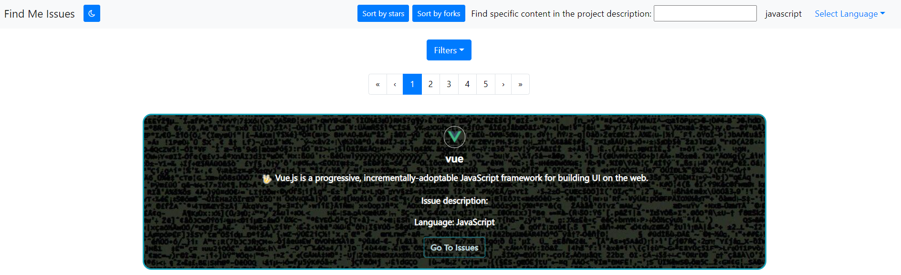

<h1 align="center">Find-Me-Issues</h1>
<p align="center">
  
  <a href="https://github.com/open-devs/fastify-typescript-generator/graphs/commit-activity" target="_blank">
    
  </a>
  <a href="https://github.com/version0chiro/Find-Me-Issues/blob/main/LICENSE" target="_blank">
    
  </a>
</p>  

> A React.js web-app to find repositories with 'good first issues' for open source contribution.

---

## Table of Contents

- [Description](#description)
- [Inspiration](#inspiration)
- [Features](#features)
- [Tech Stack](#tech-stack)
- [Set Up](#set-up)
- [How to Use](#how-to-use)
- [Contributing](#contributing)
- [License](#license)
- [Acknowledgements](#acknowledgements)

---

## Description

**Find-Me-Issues** is a user-friendly web application designed to help programmers discover open-source projects suitable for first-time contributions.  
It allows users to search beginner-friendly projects across different programming languages and filter them based on stars, forks, and keywords to match their interests.

---

## Inspiration

Finding beginner-friendly open-source projects can be challenging for new programmers.  
**Find-Me-Issues** simplifies this by providing an intuitive interface where users can filter repositories by language, number of stars, open issues, and more.

---

## Features

1. **Search Functionality:** Quickly find projects based on keywords or categories.  
2. **Filter by Programming Language:** Find projects suitable for specific languages and skill levels.  
3. **Browse Project Details:** Access project descriptions, recent issues, and direct repository links.  
4. **Sorting:** Sort projects by stars and forks to find popular repositories.  
5. **Theming:** Switch between light and dark themes for better UX.



---

## Tech Stack

<p>


</p>

---

## Set Up

```bash
# Clone the repository
git clone https://github.com/version0chiro/Find-Me-Issues.git

# Install dependencies
npm install

# Start backend
npm run start

# Build frontend
npm run build

# Access the application in your browser at http://localhost:3000

```

### How to Use

1) Search for Projects: Enter keywords or select programming languages and project categories to search for projects.

2) Filter by Starts and Forks Level: Use the starts filter and the forks filter to narrow down projects that match your experience.

3) Explore Project Details: Read the a brief description about the project and its issues.

4) Get Started: Follow the provided links to the project's repository's issues and start contributing.


## Contributing

Contributions, issues and feature requests are welcome! Guidelines can be found [here](https://github.com/version0chiro/Find-Me-Issues/blob/main/CONTRIBUTING.md).

### Issue Tracking

Find or create new and pertinent issues [here](https://github.com/version0chiro/Find-Me-Issues/issues).

Contributors are encouraged to actively participate in issue tracking by:

- Confirming Issues: If you can reproduce an issue that someone else reported, provide additional details or steps to help diagnose the problem.

- Suggesting Solutions: Offer potential solutions or workarounds for issues you've confirmed or have insight into.

- Prioritizing Issues: Project maintainers often need help in prioritizing and triaging issues. You can help by providing input on the urgency and importance of issues.

- Implementing Fixes: If you have the skills, consider contributing code to fix issues. Please follow the project's contribution guidelines when doing so.

## License

This project is open-source and available under the [MIT License](https://github.com/version0chiro/Find-Me-Issues/blob/main/LICENSE).

## Acknowledgements
<a href="https://github.com/version0chiro/Find-Me-Issues/graphs/contributors">
  
</a>

### Show your support

Give a star if this project helped you!
